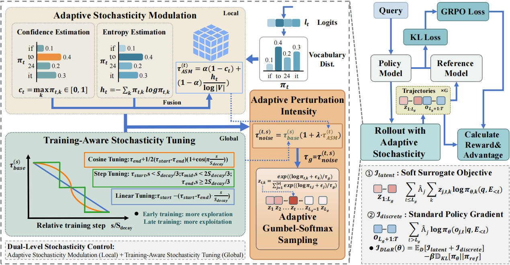

# DLaR: **D**ynamic Stochasticity Control for **La**tent **R**easoning in Large Language Models

## Abstract

Latent reasoning enables LLMs to operate in continuous embedding space, yet existing methods suffer from deterministic inference that precludes exploration of diverse reasoning paths. While recent approaches inject stochasticity to restore exploration, we identify two fundamental limitations: uniform stochasticity across all steps is suboptimal, and unconstrained perturbations disrupt reasoning coherence. We propose Dynamic Stochasticity Control for Latent Reasoning (DLaR), a framework with two complementary mechanisms that operate at different temporal granularities within the GRPO reinforcement learning framework. At the token level, Adaptive Stochasticity Modulation (ASM) dynamically adjusts perturbation intensity at each latent step based on a confidence-entropy fusion signal, increasing exploration when the model is uncertain and preserving stability when confident. At the training level, Training-Aware Stochasticity Tuning (TAST) progressively decays the base stochasticity level following a curriculum schedule. Through this dual-level design, DLaR establishes a hierarchical exploration-exploitation strategy that operates at both token and training levels. Extensive experiments on four in-distribution and three out-of-distribution mathematical reasoning benchmarks demonstrate that DLaR achieves the highest average performance across model scales, reaching 27.9%/50.6% Pass@1/Pass@8 on Llama-3.2-1B and 46.8%/68.2% on Qwen2.5-1.5B. Code: https://github.com/xiaocen-luo/DLaR.



## 📁 Project Structure

```
lepo/
├── configs/
│   ├── accelerate/           # Accelerate/DeepSpeed configurations
│   ├── grpo/                 # Standard GRPO training configs
│   ├── dlar/                 # DLaR training configs
│   └── eval/                 # Evaluation configs
├── scripts/
│   ├── train_grpo.py         # Standard GRPO training script
│   ├── train_dlar.py         # DLaR training script
│   ├── eval_latent.py        # Distributed evaluation script
│   └── run_eval.sh           # Evaluation launch script
├── src/
│   ├── models/               # Model definitions (LatentQwen2, LatentLlama)
│   ├── trainers/             # Trainers (DLaRTrainer, GRPOTrainer)
│   ├── rewards/              # Reward functions
│   ├── data/                 # Dataset loading
│   └── utils/                # Utility functions
└── outputs/                  # Training output directory
```

## 🛠️ Installation

**Requirements**: Python 3.12, CUDA ≥ 12.4 (recommended)

```bash
# Create conda environment
conda create -n dlar python=3.12
conda activate dlar

# Install PyTorch (choose based on your CUDA version)
pip install torch torchvision torchaudio --index-url https://download.pytorch.org/whl/cu124

# Install dependencies
pip install -r requirements.txt

# Install evaluation dependencies
cd Soft-Thinking/sglang_soft_thinking_pkg
pip install -e "python[all]"
cd ../..
```

## 🚀 Quick Start

### 1. Standard GRPO Training

```bash
accelerate launch --config_file configs/accelerate/ds_zero2.yaml \
    scripts/train_grpo.py \
    --config configs/grpo/llama3_1b_grpo.yaml
```

Checkpoints will be saved to `./outputs/` (see `output_dir` in the config).

### 2. DLaR Training

```bash
accelerate launch --config_file configs/accelerate/ds_zero2.yaml \
    scripts/train_dlar.py \
    --config configs/dlar/llama3_1b.yaml
```

Checkpoints will be saved to `./outputs/Llama3-1B-DLaR` by default.

### 3. Model Evaluation

Before evaluation, update the model architecture in the checkpoint config so that the standard HF model class can be loaded:

```bash
# Step 1: Update the model architecture in the checkpoint
cd ./-llama-DLaR/checkpoint-50
open config.json
# In the "architectures" field, replace the model class as follows:
#     "LatentLlamaForCausalLM" -> "LlamaForCausalLM"
#     "LatentQwen2ForCausalLM" -> "Qwen2ForCausalLM"

# Step 2: Specify the model path and run evaluation
cd ./Soft-Thinking
bash ./scripts/st/test_all_models.sh
```

## ⚙️ Configuration Guide

### Training Configuration (DLaR)

```yaml
# configs/dlar/llama3_1b.yaml
model:
  path: "Llama/Llama3-1B"      # HuggingFace model name or local path

training:
  num_train_epochs: 1
  per_device_train_batch_size: 1
  gradient_accumulation_steps: 8
  learning_rate: 1.0e-6
  num_generations: 8            # Number of samples generated per prompt
  max_completion_length: 2048

latent:
  latent_length: 32             # Number of latent tokens
  noise_type: "gumbel"          # Noise type: gumbel, gaussian, uniform

  use_confidence_guided_noise: true   # Control switch for ASM
  use_adaptive_noise: true            # Control switch for TAST

  # Confidence Weight (α)
  confidence_weight: 0.1
  entropy_weight: 0.9
  # Crop to a safe area
  min_noise_strength: 0.01
  max_noise_strength: 0.3

  # Stochasticity Tuning Schedule
  noise_schedule: "linear"   # linear, cosine, step, none
  noise_warmup_steps: 1000   # Number of warmup steps before decay starts
  noise_start_strength: 0.25 # Initial base stochasticity (τ_start)
  noise_end_strength: 0.50   # End base stochasticity (τ_end)

dataset:
  name: "dapo"                  # Dataset name
  subset: "en"                  # Subset (if applicable)

output_dir: "./outputs/Llama3-1B-DLaR"
```

### Evaluation Configuration

```bash
# Set up basic parameters
MODEL_PATH="Llama/Llama3-1B"  # Model path or HuggingFace name
NUM_GPUS=1
NUM_SAMPLES=1  # Pass@1 or Pass@8
MAX_GENERATED_TOKENS=2048
MEM_FRACTION_STATIC=0.3  # Reduce to avoid OOM
START_IDX=0
END_IDX=10000

# Create log directory
LOG_DIR="logs"
mkdir -p $LOG_DIR

# Dataset List
DATASETS=("gsm8k" "math500" "minervamath" "amc23")

# Model Configuration List
# Format: "config_name|extra_args"
CONFIGS=(
    "Base|"
    "SoftThinking_Gumbel|--enable_soft_thinking --add_noise_gumbel_softmax --gumbel_softmax_temperature 0.5"
)
```

## 🤖 Supported Models

- **Qwen2.5 Series**: `Qwen/Qwen2.5-1.5B`, `Qwen/Qwen2.5-3B`, ...
- **Llama 3.2 Series**: `meta-llama/Llama-3.2-1B-Instruct`, `meta-llama/Llama-3.2-3B-Instruct`, ...

## 📊 Supported Datasets

| Dataset | Name | Description |
|---------|------|-------------|
| GSM8K | `gsm8k` | Grade school math word problems |
| MATH-500 | `math500` | Competition math problems (500-question subset of MATH) |
| MATH | `math` | Full MATH dataset |
| DAPO | `dapo` | Math training data |
| MinervaMath | `minervamath` | Minerva math dataset |
| AMC23 | `amc23` | American Mathematics Competition 2023 |
| ARC-C | `arcc` | AI2 Reasoning Challenge |
| GPQA | `gpqa_diamond` | Graduate-level STEM |
| MMLU-STEM | `mmlust` | MMLU STEM subset |

## 📝 Citation

If you find our work helpful for your research, please consider giving a star ⭐ and citing our paper:

```bibtex
@article{luo2027dlar,
  title={DLaR: Dynamic Stochasticity Control for Latent Reasoning in Large Language Models},
  author={},
  journal={},
  year={2027}
}
```

## 🙏 Acknowledgments

- **LEPO**: The codebase we built upon. Thanks for their wonderful work.
- **Soft-Thinking**: Our evaluation is based on this codebase as well.

## 📄 License

<!-- TODO: add license (e.g., MIT / Apache-2.0) -->
This project is released under the [LICENSE](LICENSE) file in the repository.